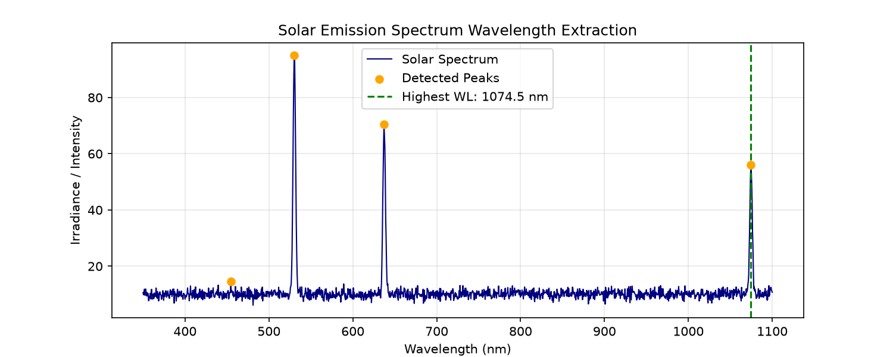

# fetch_eclipse_data.py
To connect directly to LASP / NASA's LISIRD Solar Spectral Irradiance API and download the exact wavelength-vs-irradiance data files for the solar eclipses onSeptember 21, 2025, February 17, 2026, and August 12, 2026

To find the highest emitted Wavelength during the solar eclipses 
# Solar Eclipse Wavelength Extractor

A Python signal-processing tool that analyzes solar emission spectra during a solar eclipse to isolate emission peaks above background noise and extract the **highest (longest) emitted wavelength** alongside the **strongest peak intensity wavelength**.

## Key Features
* **Noise Floor Estimation:** Uses Median Absolute Deviation (MAD) to separate genuine coronal emission lines from background noise.
* **Peak Detection:** Applies `scipy.signal.find_peaks` with prominence filtering to locate spectral emission lines.
* **Automated Visualization:** Generates annotated spectrum plots highlighting all detected peaks and the longest emitted wavelength.

## Sample Output


* **Highest (Longest) Emitted Wavelength:** `1074.48 nm` (Near-Infrared Fe XIII coronal line)
* **Strongest Peak Intensity Wavelength:** `530.12 nm` (Green Fe XIV coronal line)

## How to Run
1. Install dependencies:
   ```bash
   pip install -r requirements.txt
   ```
2. Run the analysis script:
   ```bash
   python main.py
   ```
